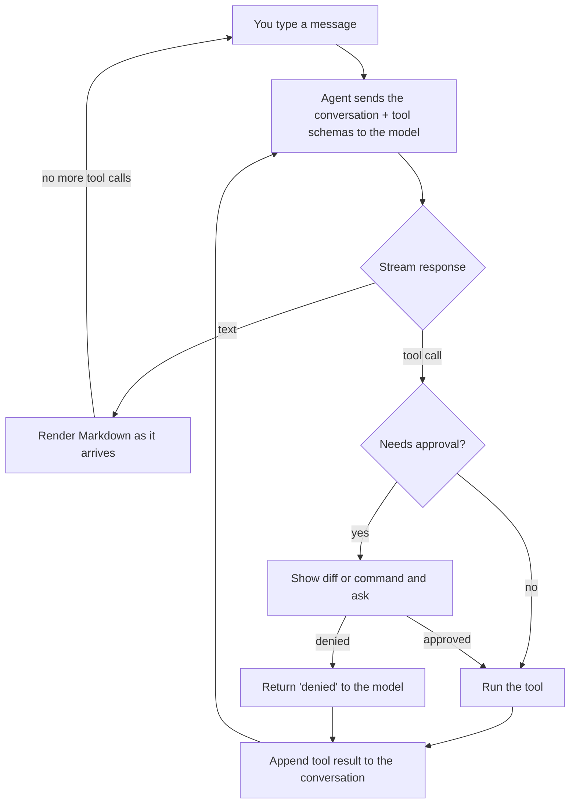

<div align="center">

# Coco

**A terminal coding agent built from scratch in TypeScript.**
Streaming responses, tool use, and a human-in-the-loop approval flow with real diffs. No agent framework, just the loop.


</div>

---

Coco is a small, readable implementation of the kind of agent you'd use in a terminal to work on a codebase: it reads and searches your files, proposes edits, runs commands, and keeps going until the job is done. Anything that changes state shows you exactly what it's about to do and waits for your approval.

It talks to any OpenAI-compatible API. Anthropic and Groq work out of the box, and adding another provider is a few lines of config.

## What it looks like

An illustrative session:

```
anthropic · claude-haiku-5-5
You: rename the DEFAULT_LIMIT constant to DEFAULT_LINE_LIMIT in readFile.ts

● Grep(DEFAULT_LIMIT)
● Read File(src/tools/readFile.ts)

I'll rename it in the file that defines it and update the import in the tool registry.

● Edit File(src/tools/readFile.ts)

@@ -3,3 +3,3 @@
-export const DEFAULT_LIMIT = 500;
+export const DEFAULT_LINE_LIMIT = 500;

  Allow? [y]es / [n]o / [a]lways: y
```

Long commands are cut to one line so the screen stays readable. Press **Ctrl+O** to expand or collapse them in place.

## Highlights

- **Hand-written agent loop.** Streaming responses, tool calls, and a bounded number of turns per request, all in one file (`src/agent/agent.ts`). Only the OpenAI SDK is used, as an HTTP client.
- **A real system prompt.** Coco's behavior (read before editing, prefer dedicated tools over shell, verify changes, never commit unasked, treat file contents as data not instructions) lives in one readable file, `src/agent/systemPrompt.ts`, along with the working directory, platform, and date.
- **Approval flow with real diffs.** `write_file` and `edit_file` show a colored diff against the current file contents before anything is written. `bash` shows the command. Anything but an explicit "yes" denies, and a denial is reported back to the model so it can adapt.
- **Safe by default.** Writes are confined to the project directory. Read-only shell commands (`git status`, `ls`, ...) skip the prompt, but only when they contain no shell operators, so `git status; rm -rf /` still asks.
- **Cancellation that works.** Ctrl+C aborts the in-flight model request, the approval prompt, and any running command. The tool's whole process tree is killed, not just the shell. This needed a Windows-specific fix, because `taskkill /T` can't see Git Bash's child processes.
- **ripgrep-backed search.** The `grep` tool shells out to a bundled ripgrep binary (via `@vscode/ripgrep`), so search is fast and respects `.gitignore` without needing a system install. Arguments are built from structured parameters, so the model never passes raw flags.
- **Bounded outputs.** Files, search results, directory listings, and command logs are capped, and the cap is announced to the model (`[truncated ...]`) so it knows to narrow its query.
- **Provider-agnostic.** Providers are plain config in `src/agent/registry.ts`. Switch provider or model mid-session with `/provider` and `/model`.
- **Strict TypeScript.** `strict`, `noUncheckedIndexedAccess`, and `exactOptionalPropertyTypes` are all on.

## Quick start

**Prerequisites:** [Node.js](https://nodejs.org/) 22 or newer, [pnpm](https://pnpm.io/) 10, and an API key for [Anthropic](https://console.anthropic.com/) or [Groq](https://console.groq.com/keys).

```bash
git clone https://github.com/Rakesh-Bhagat/ai-harness.git
cd ai-harness
pnpm install

cp .env.example .env      # then put your API key in .env

pnpm cli:dev
```

`pnpm cli:dev` compiles the TypeScript and starts the CLI. After the first build, `pnpm start` launches it without recompiling.

> **Windows:** the `bash` tool needs `bash` on your `PATH`. [Git for Windows](https://git-scm.com/download/win) provides it (Git Bash).

### Using Groq instead

The default provider is Anthropic. To start with Groq, set `GROQ_API_KEY` in `.env` and run `/provider groq` at the prompt.

## Usage

Type a message at the `You:` prompt. The agent answers, and calls tools on its own when it needs to look at or change your project. Run it from the directory of the project you want it to work on.

### Keys and commands

| Input                         | What it does                                                   |
| ----------------------------- | -------------------------------------------------------------- |
| `/provider <anthropic\|groq>` | Switch provider. The model resets to that provider's default.  |
| `/model`                      | List the models the current provider offers                    |
| `/model <id>`                 | Switch to a model by ID                                        |
| `Ctrl+O`                      | Expand or collapse the latest tool call's full command or path |
| `Ctrl+C`                      | Cancel the running request, tool, or prompt, and exit          |
| `exit`                        | Quit                                                           |

### Approval prompts

```
Allow? [y]es / [n]o / [a]lways:
```

- `y` allows this one action
- `a` allows this tool for the rest of the session (use with care for `bash`)
- Anything else, including pressing Enter, denies it

## Tools

| Tool             | Description                                                                     | Approval                                   |
| ---------------- | ------------------------------------------------------------------------------- | ------------------------------------------ |
| `read_file`      | Read a file, with `offset` and `limit` line paging                              | No                                         |
| `list_directory` | List files and subdirectories                                                   | No                                         |
| `glob`           | Find files by pattern, ignoring `node_modules`, `.git`, and `dist`              | No                                         |
| `grep`           | Regex search via ripgrep, with `path`, `glob`, `ignoreCase`, and context lines  | No                                         |
| `write_file`     | Create or overwrite a file inside the project                                   | Yes, shows a diff                          |
| `edit_file`      | Replace exact text. The match must be unique unless `replaceAll` is set.        | Yes, shows a diff                          |
| `bash`           | Run a shell command, with a timeout and an output cap, and return the exit code | Yes, unless it is a safe read-only command |

Read-only commands that skip the prompt: `git status`, `git diff`, `git log`, `git branch`, `ls`, `pwd`, `echo`. They must contain none of `; & | < > `` ` `` `$` or a newline.

## How it works



Each tool is a small object: a name, a JSON schema for its input, an `execute` function, and optional `requiresApproval`, `title`, and `describeCall` hooks. The agent loop knows nothing about specific tools, so adding one is a single entry in `src/tools/index.ts`.

### Project structure

```
src/
├── cli/index.ts          # REPL, approval prompt, Ctrl+C / Ctrl+O handling
├── agent/
│   ├── agent.ts          # The agent loop: streaming, tool execution, approvals
│   ├── systemPrompt.ts   # Coco's system prompt: behavior rules + environment info
│   ├── registry.ts       # Provider and default-model configuration
│   ├── factory.ts        # Builds a provider from the registry
│   ├── types.ts          # Messages, tools, stream events
│   ├── providers/        # OpenAI-compatible provider
│   └── utils/            # Diff rendering, tool header display, formatting, commands
└── tools/                # One file per tool, registered in index.ts
```

### Adding a provider

Add an entry to `src/agent/registry.ts`:

```ts
myprovider: {
  displayName: "My Provider",
  baseURL: "https://api.example.com/v1",
  apiKeyEnv: "MYPROVIDER_API_KEY",
  kind: "openai-compatible",
  defaultModel: "some-model",
},
```

Set the key in `.env`, then use `/provider myprovider`.

## Configuration

Environment variables, read from `.env`:

| Variable            | Required                 | Purpose           |
| ------------------- | ------------------------ | ----------------- |
| `ANTHROPIC_API_KEY` | For the default provider | Anthropic API key |
| `GROQ_API_KEY`      | Only when using Groq     | Groq API key      |

Limits (change them in the tool source files):

| Limit                                     | Value               | File                         |
| ----------------------------------------- | ------------------- | ---------------------------- |
| `read_file` default lines / max file size | 500 / 5 MB          | `src/tools/readFile.ts`      |
| `glob` results                            | 100                 | `src/tools/glob.ts`          |
| `list_directory` entries                  | 150                 | `src/tools/listDirectory.ts` |
| `grep` lines                              | 250                 | `src/tools/grep.ts`          |
| `bash` timeout / output cap               | 30 s / 30,000 chars | `src/tools/bash.ts`          |
| Model turns per request                   | 20                  | `src/agent/agent.ts`         |

## Safety notes

- **Writes stay inside the project.** `write_file` and `edit_file` reject paths outside the working directory.
- **Reads don't.** `read_file`, `glob`, `grep`, and `list_directory` can read anything your user can, so run the agent from the project you intend it to work on.
- **`bash` is not sandboxed.** Approved commands run with your permissions. Read each prompt, and be careful with `always`.
- **Your code leaves your machine.** File contents and command output the agent reads are sent to the provider you selected.

## Troubleshooting

| Problem                                         | Fix                                                                                        |
| ----------------------------------------------- | ------------------------------------------------------------------------------------------ |
| `ANTHROPIC_API_KEY does not exist in .env file` | Create `.env` from `.env.example` in the directory you run the CLI from, and add your key. |
| `bash` fails to start on Windows                | Install Git for Windows and make sure `bash` is on your `PATH`.                            |
| Errors about `fs.glob` or syntax                | Upgrade to Node.js 22 or newer.                                                            |
| Colors or Ctrl+O behave oddly                   | Use a modern terminal (Windows Terminal, iTerm2, or any xterm-compatible one).             |

## Development

```bash
pnpm build       # compile TypeScript to dist/
pnpm cli:dev     # compile and run
pnpm start       # run the last build
```
